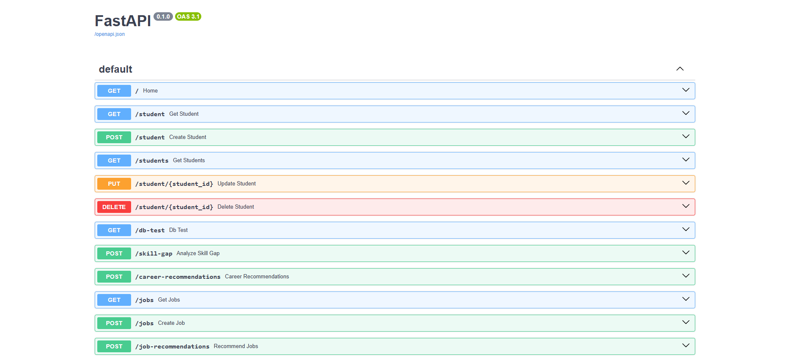
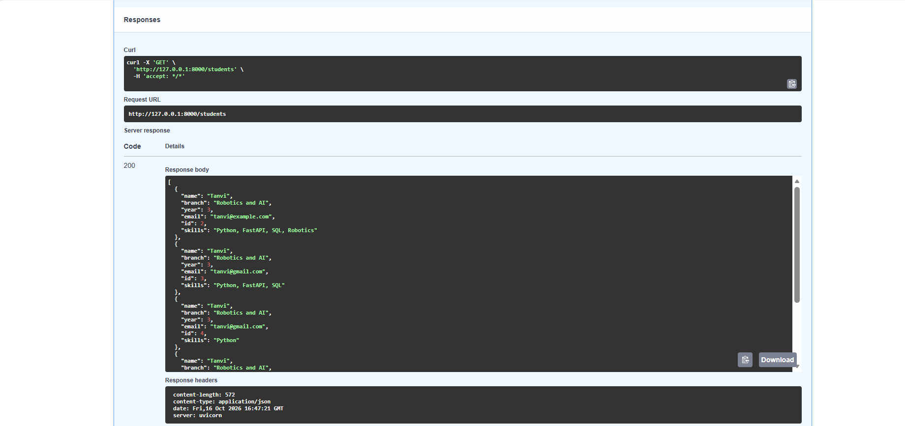
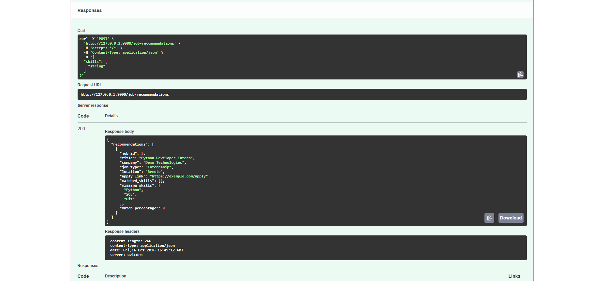

# AI Student Career Assistant

An AI-powered student career assistance project built using Python, FastAPI, and PostgreSQL. This project helps students manage their profiles, identify skill gaps, explore career paths, and receive job recommendations based on their skills.

## Features

- Student profile creation and management
- User registration with email validation
- Secure password hashing using Argon2
- User login and password verification
- JWT-based authentication
- Protected user profile endpoint
- Environment variable configuration using `.env`
- Student data storage using PostgreSQL
- Skill gap analysis
- Career recommendations based on student skills
- Job and internship record management
- Job recommendations based on matching skills
- Input validation using Pydantic
- REST API testing using Swagger UI
- Interactive API documentation

## Tech Stack

- **Programming Language:** Python
- **Backend Framework:** FastAPI
- **Database:** PostgreSQL
- **ORM:** SQLAlchemy
- **Data Validation:** Pydantic
- **Authentication:** JSON Web Token (JWT)
- **Password Hashing:** Argon2 using `pwdlib`
- **Environment Variables:** python-dotenv
- **API Documentation:** Swagger UI
- **Version Control:** Git and GitHub

## Project Structure

```text
AI-Student-Career-Assistant/
│
├── main.py
├── models.py
├── database.py
├── requirements.txt
├── .gitignore
├── README.md
│
└── screenshots/
    ├── api-documentation.png.png
    ├── students-api.png.png
    └── job-recommendations.png.png
```


## Getting Started

### 1. Clone the Repository

```bash
git clone https://github.com/tanvikhalokar-cloud/AI-Student-Career-Assistant.git
cd AI-Student-Career-Assistant
```

### 2. Create a Virtual Environment

```powershell
python -m venv venv
```

Activate it in Windows PowerShell:

```powershell
.\venv\Scripts\Activate.ps1
```

### 3. Install Dependencies

```powershell
pip install -r requirements.txt
```

### 4. Configure PostgreSQL

- Install and start PostgreSQL.
- Create a database for the project.
- Configure your database connection in `database.py` using your local PostgreSQL credentials.


### 5. Configure Environment Variables

Create a `.env` file in the project's root directory, alongside `main.py`.

Add your own securely generated secret key:

```env
SECRET_KEY=replace-with-your-own-random-secret-key
```


### 6. Run the Application

```powershell
python -m uvicorn main:app --reload
```

The server should start at:

`http://127.0.0.1:8000`

### 7. Open Swagger UI

Visit:

http://127.0.0.1:8000/docs


## Main API Endpoints

| Method | Endpoint | Description |
|---|---|---|
| GET | `/` | Check application status |
| POST | `/register` | Register a new user |
| POST | `/login` | Log in and receive a JWT access token |
| GET | `/profile` | Retrieve the authenticated user's profile |
| POST | `/student` | Create a student record |
| GET | `/students` | Retrieve student records |
| PUT | `/student/{student_id}` | Update a student record |
| DELETE | `/student/{student_id}` | Delete a student record |
| POST | `/skill-gap` | Analyze missing skills |
| POST | `/career-recommendations` | Get career recommendations based on student skills |
| POST | `/jobs` | Add a job or internship |
| GET | `/jobs` | Retrieve saved jobs |
| POST | `/job-recommendations` | Get skill-based job recommendations |

## Authentication

The project implements user registration, login, password hashing, and JWT-based authentication.

1. Send a request to `POST /register` to create an account.
2. Use `POST /login` with the registered credentials.
3. Copy the `access_token` from the login response.
4. Click **Authorize** in Swagger UI and enter the token in the format requested by the authentication dialog.
5. Send a request to `GET /profile` to access the authenticated user's profile.

The profile endpoint requires a valid access token. Missing, invalid, and expired tokens should be rejected.

## Project Screenshots

### 1. API Documentation

This screenshot shows the interactive API documentation available through FastAPI Swagger UI.



### 2. Student API Response

This screenshot demonstrates the student API response.



### 3. Job Recommendations

This screenshot demonstrates the job recommendation API.



## Current Limitations

- Job recommendations use job records stored in the project database.
- Live job scraping and external job feeds are not implemented yet.
- The project currently provides backend API functionality; a dedicated frontend dashboard is not yet implemented.
- Automated tests are implemented using Pytest, with 19 tests currently passing.
- Production deployment is still pending.

## Future Enhancements

- Resume upload and parsing
- Live job and internship data integration
- Aptitude practice and interview preparation
- Student dashboard and frontend development
- Expand automated test coverage and add integration tests
- Cloud deployment
- Improved career recommendations using machine learning
- Enhanced user profile management
- Production-ready authentication and authorization

## Author

**Tanvi Khalokar**

## Project Status

Under active development.
